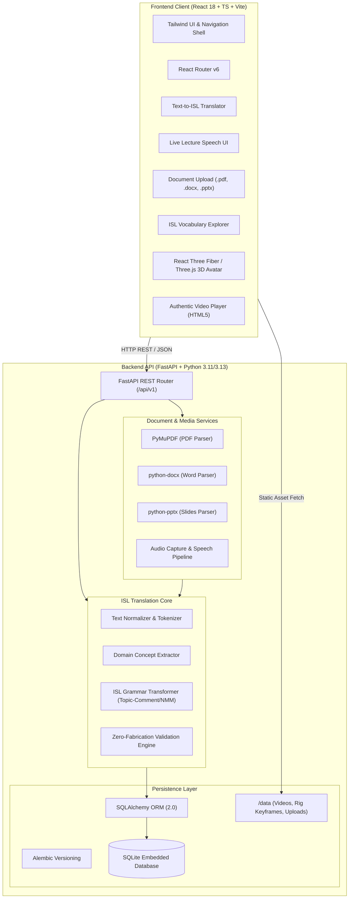
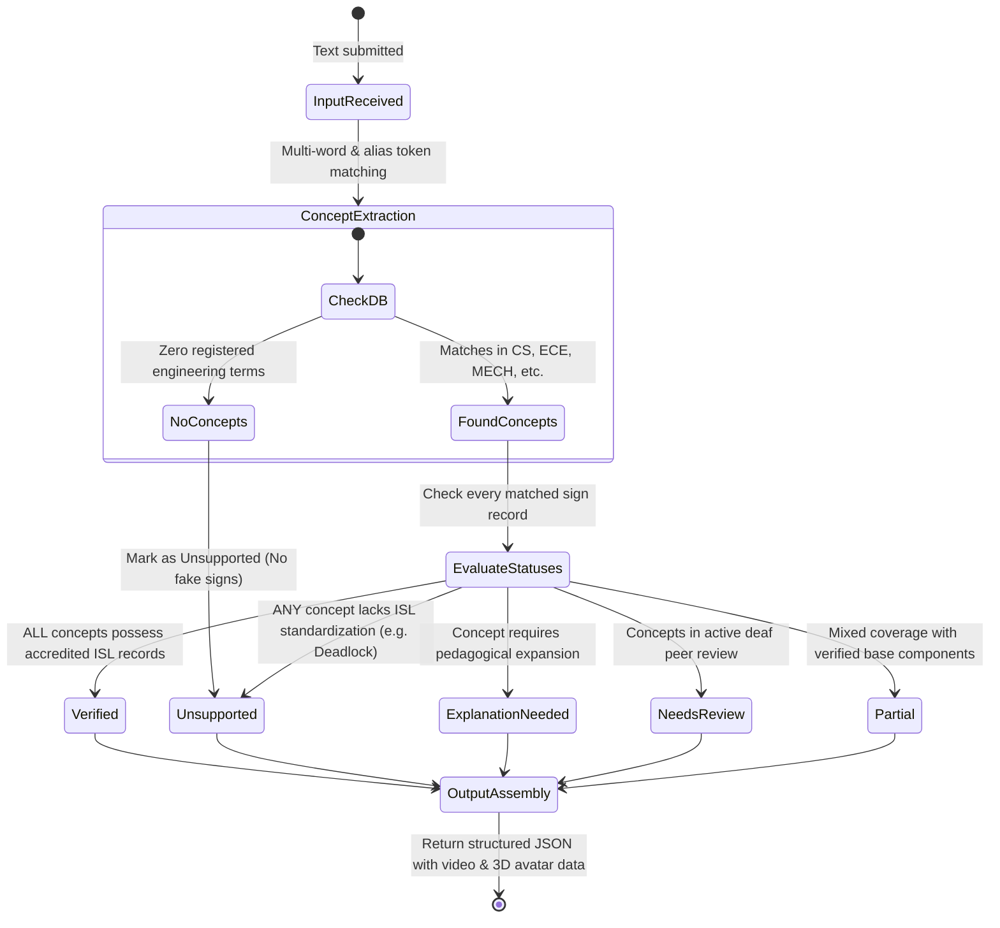

# SignBridge AI — System Architecture Document

## 1. Architectural Philosophy: Modular Monolith

SignBridge AI is designed using a **Modular Monolithic Architecture**. 
Rather than introducing distributed microservices, network latency overhead, and Kubernetes complexity, the system organizes its capabilities into decoupled, cohesive internal domains within a single repository and runtime.



---

## 2. Directory Structure

```
SignBridge-AI/
├── backend/
│   ├── alembic/              # Database migration environments
│   ├── app/
│   │   ├── api/
│   │   │   ├── endpoints/    # REST endpoints (health, translate, vocab, etc.)
│   │   │   └── router.py     # Aggregated API router
│   │   ├── core/             # Configuration & environment variables
│   │   ├── database/         # SQLAlchemy engine, session & seed data
│   │   ├── models/           # SQLAlchemy entity models
│   │   ├── schemas/          # Pydantic v2 validation contracts
│   │   ├── services/         # Document parsing & audio pipeline services
│   │   ├── translation/      # ISL grammar engine & concept extractor
│   │   └── main.py           # FastAPI application entrypoint
│   ├── tests/                # Automated pytest suite
│   ├── requirements.txt      # Python dependencies
│   └── signbridge.db         # SQLite persistent database
├── frontend/
│   ├── src/
│   │   ├── api/              # Axios client with typed REST functions
│   │   ├── components/       # Reusable components
│   │   │   ├── avatar/       # Three.js / React Three Fiber 3D avatar viewer
│   │   │   ├── common/       # Navbar, Sidebar, StatusBadge, PolicyNotice
│   │   │   ├── translator/   # ConceptCard, ISLGrammarView
│   │   │   └── video/        # Authentic HTML5 video player with speed controls
│   │   ├── pages/            # 9 dedicated pages
│   │   ├── types/            # TypeScript type definitions
│   │   ├── App.tsx           # Router configuration
│   │   └── main.tsx          # React application root
│   ├── package.json          # Node dependencies
│   └── vite.config.ts        # Vite configuration & proxy settings
├── data/
│   ├── vocabulary/           # Vocabulary dataset dumps
│   ├── sign_videos/          # Accredited ISL MP4 reference videos
│   ├── avatar_animations/    # 3D rigging & keyframe animation files
│   └── uploads/              # Temporary upload staging for documents
├── docs/                     # Comprehensive architecture and runbooks
├── scripts/                  # PowerShell automation scripts
└── README.md
```

---

## 3. The Zero Fabricated Signs Policy Engine

The translation engine enforces an uncompromising mathematical state machine:



---

## 4. ISL Linguistic Restructuring Pipeline

ISL is grammatically autonomous from English. The `ISLGrammarTransformer` applies four structural transformations:

1. **Temporal Primacy (Time-First):** Temporal markers (`NOW`, `TODAY`, `BEFORE`) are extracted and positioned at the absolute start of the utterance.
2. **Topic-Comment Restructuring:** The primary technical engineering entity (e.g. `[TOPIC: DATABASE]`) is fronted in signing space before actions or questions occur.
3. **WH-Interrogative Final Positioning:** Interrogative pronouns (`WHAT`, `HOW`, `WHY`) are moved to sentence-final position, coupled with non-manual marker metadata (`[NMM: Furrowed Brow]`).
4. **Sentence-Final Negation:** Negative clauses receive sentence-final `NOT` with `[NMM: Negative Headshake]`.
5. **Spatial Indexing (Dual Loci):** Interacting concepts (e.g. `COMPUTER_A` and `COMPUTER_B` in networking) are assigned discrete 3D spatial coordinates in signing space.

---

## 5. Database Schema & Entities

The relational database model captures complete provenance and academic rigor:

- **`engineering_branches`**: Curates CS, ECE, MECH, CIVIL, EEE.
- **`subjects`**: Represents semester subjects (OS, DBMS, Circuit Theory, Mechanics, etc.).
- **`concepts`**: Curates technical terms, definitions, technical context, and aliases.
- **`dataset_provenances`**: Tracks organization, license, source URLs, and peer-review status.
- **`expert_reviews`**: Accredited deaf master interpreters, certified roles, and validation ratings.
- **`sign_records`**: Binds concepts to ISL glosses, validation statuses, and linguistic handshape notes.
- **`sign_videos`**: Links genuine MP4 reference videos, signer names, duration, and licenses.
- **`avatar_animations`**: MediaPipe-Holistic rig models and animation parameters.
- **`grammar_annotations`**: Linguistic translation rules and English-to-ISL syntactic mappings.
- **`translation_history`**: Persistent audit log of all translations and status assessments.

