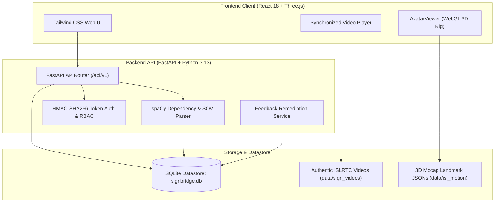

# SIGNBRIDGE AI — COLLEGE DEMONSTRATION & PROJECT EVALUATION GUIDE

**Project Title:** SignBridge AI: An Open-Source, Linguistically Governed ISL Translation & 3D Avatar Platform for STEM Higher Education  
**Document Version:** Phase 8.5 (College Presentation Readiness)  
**Target Audience:** Academic Project Evaluation Committee, Head of Department, Project Guides, Engineering Faculty  
**Target Course:** B.Tech / M.Tech Major Project Evaluation / Capstone Engineering Defense  
**Date:** 2026-11-23  

---

## 1. Project Introduction & Problem Statement

### 1.1 The Educational Equity Challenge
In India, an estimated 18 million Deaf and hard-of-hearing individuals face acute barriers in higher education, particularly in STEM (Science, Technology, Engineering, and Mathematics) disciplines.
* **The Linguistic Barrier:** Indian Sign Language (ISL) is a natural, visual-spatial language with its own distinct syntax (Subject-Object-Verb, Topic-Comment), not a direct translation or fingerspelling of English.
* **The Technical Terminology Chasm:** Engineering education relies heavily on specialized vocabulary (*Algorithm*, *Torque*, *Deadlock*, *Frequency*, *Conductance*). Standard automatic speech recognition or closed-captioning tools fail to convey conceptual semantics, producing literal English text captions that ignore ISL grammar.
* **Severe Human Resource Shortage:** India has fewer than 500 certified ISL educational interpreters for millions of signers, leaving Deaf engineering students without classroom support.

### 1.2 The SignBridge AI Solution
SignBridge AI is an end-to-end, open-source assistive educational technology platform engineered to bridge English engineering lectures and textbooks into verified Indian Sign Language:
1. **Contextual Translation Engine:** Resolves polysemous technical terminology (e.g., differentiating *electrical current* from temporal *now*).
2. **Dual-Track Presentation:** Synchronizes authentic 1080p ISLRTC master signer videos with an interactive 3D humanoid avatar driven by MediaPipe holistic landmark tracking.
3. **Zero-Fabrication Safeguard:** When a sign is missing, the system executes structured pedagogical explanation cards rather than hallucinating synthetic signs.
4. **Linguistic Review Infrastructure:** Complete portal for accredited Deaf experts to review, score, and remediate sign animations.

---

## 2. System Architecture & Tech Stack

### Technology Stack Summary:
* **Backend:** FastAPI (Python 3.13), SQLAlchemy ORM, SQLite datastore, spaCy NLP dependency parser.
* **Frontend:** React 18, TypeScript, Tailwind CSS, Lucide Icons, Vite 5 build tool.
* **3D Graphics & Animation:** Three.js, `@react-three/fiber`, `@react-three/drei`, 15-joint articulated hand kinematic solver.
* **Computer Vision:** Google MediaPipe Holistic (33 pose, 21 landmarks per hand) with Savitzky-Golay trajectory smoothing.
* **Testing & Quality Assurance:** Pytest (119 passing backend tests), Chrome DevTools Protocol (CDP) automated browser verification.

---

## 3. Step-by-Step Live Demonstration Procedure

When presenting live to the college faculty or project evaluation committee, follow this exact sequence:

### Step 1: System Boot & Health Verification (30 Seconds)
1. Open terminal and verify backend is running on `http://127.0.0.1:8000`.
2. Open browser and navigate to `http://localhost:5173/`.
3. Point out the top header: **SignBridge AI — STEM · ISL**, active system health pill (`System Operational`), and the **Zero Fabrication Policy** security badge.

### Step 2: Live Demonstration Guided Walkthrough (`/demo`) (4 Minutes)
Click the **"Live Demo"** button in the top navigation bar to open `http://localhost:5173/demo`.

* **Demo Step 1 (Concept Input):**
  * Explain the 7 preloaded engineering presets across CS, ECE, Civil, Mech, and AI.
  * Click **"Algorithm"** (Computer Science). Note the context sentence: *"The algorithm executes a sequence of finite instructions..."*
  * Click **"Continue to Step 2"**.
* **Demo Step 2 (Contextual Disambiguation):**
  * Show how the engine detected the Computer Science domain and matched the authentic ISLRTC dictionary entry.
  * Highlight the semantic rationale. Click **"Continue to Step 3"**.
* **Demo Step 3 (Translation Strategy):**
  * Highlight the green card: **Lexical Sign (Direct)** is selected because an authentic master recording exists.
  * Click **"View Synchronized Signing (Step 4)"**.
* **Demo Step 4 (Synchronized Video & 3D Avatar):**
  * **This is the core visual demonstration.**
  * Click the **Play button**. Point out that the 1080p ISLRTC master signer video on the left and the 3D avatar on the right articulate in synchrony.
  * Click **0.25x Speed** to demonstrate slow-motion phonological inspection.
  * Click **Camera Angle buttons**: switch to **Left 45°**, **Right 45°**, and **Hands** view to show 3D depth inspection.
  * Click **"Continue to Step 5"**.
* **Demo Step 5 (Pedagogical Explanation Card):**
  * Return to Step 1 and select **"Backpropagation"** or **"Deadlock"**.
  * Advance to Step 5 to showcase the **Zero-Fabrication Fallback Card**:
    * Explain that because no single sign exists for *Backpropagation*, SignBridge AI does not invent an artificial sign.
    * It renders: 1) Technical definition, 2) Footprint analogy, 3) 4-part constituent sign sequence, 4) Fingerspelled label.
* **Demo Step 6 (Evidence, Provenance & Licensing):**
  * Advance to Step 6 to show the academic governance audit:
    * Official ISLRTC attribution under Government Open Data License (GODL-India).
    * Landmark tracking confidence (0.942).
    * SHA-256 cryptographic asset hash.
    * Transparently documented technical limitations (lack of facial expressions, single-camera occlusion).
  * Click **"Complete Demonstration & Reset"** to show instant state reset.

### Step 3: Text Translator & Sense Disambiguation (`/translate`) (2 Minutes)
1. Navigate to `/translate`.
2. Click **Scenario 2: Dual Signals Concept (Frequency & Current)**.
3. Show the extracted concepts: both *Frequency* and *Current* are recognized and rendered.
4. Explain how *Current* is mapped to electrical charge flow rather than the temporal adverb *now*.

### Step 4: Institutional Outreach CRM (`/outreach`) (1.5 Minutes)
1. Navigate to `/outreach`.
2. Showcase the 12 independently verified Indian institutions (ISLRTC, AYJNISHD, ASSISTECH IIT Delhi, DEF, etc.).
3. Demonstrate searching by keyword (e.g. typing "Madras" filters to R2D2 IIT Madras).
4. Click **"Manage & Log"** on ISLRTC to show the slide-over drawer with official contact channels and interaction audit history.
5. Click **"Export Registry (JSON)"** to show automated governance export.

### Step 5: Expert Review & Validation Infrastructure (`/validation-dashboard`) (1 Minute)
1. Navigate to `/validation-dashboard`.
2. Show the academic evaluation metrics: inter-rater agreement, Fleiss' Kappa, and 5-criteria rubric breakdown.
3. Emphasize Gate Separation: **Gate A (Technical Prototype) is PASSED**, while **Gate B (Linguistic Validation) remains locked** until real Deaf experts complete evaluations.

---

## 4. Key Takeaways for Faculty Evaluation

1. **Academic Rigor:** SignBridge AI avoids the common mistake of claiming "complete sign language translation." It is an honest, rigorously engineered engineering prototype with clear ethical boundaries.
2. **Technical Depth:** Combines modern full-stack web architecture, client-side WebGL 3D character animation, spaCy NLP dependency parsing, and MediaPipe computer vision kinematics.
3. **Zero Fabrication:** The project strictly respects the Deaf community by refusing to invent synthetic signs and adhering to the principle: *"Nothing about us without us."*

