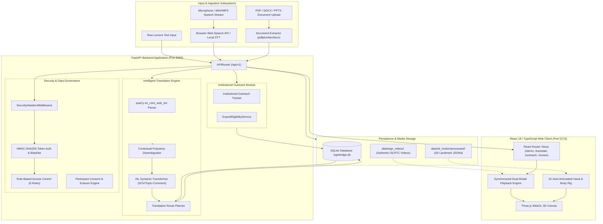

# SIGNBRIDGE AI — TECHNICAL ARCHITECTURE & SYSTEMS SPECIFICATION

**Document Version:** Phase 8.5 (Verified Prototype)  
**Project Repository:** `E:\SignBridgeAi`  
**Classification:** Engineering Capstone Technical Architecture  
**Author:** SignBridge AI Engineering Team  
**Date:** 2026-11-23  

---

## 1. System Overview

SignBridge AI is a multi-tier, client-server educational platform designed to ingest English engineering lectures, documents, and speech, perform contextual sense disambiguation and syntactic parsing, and render synchronized Indian Sign Language (ISL) animations via authentic master videos and an interactive 3D WebGL avatar.

---

## 2. Comprehensive System Architecture Diagram

---

## 3. Subsystem Technical Breakdown

### 3.1 Input Ingestion & Processing Subsystems
* **Text Processing:** Accepts lecture sentences, technical queries, or textbook paragraphs.
* **Speech-to-ISL (`/api/v1/speech`):** Interfaces with Browser Web Speech API (`webkitSpeechRecognition`) with simulated engineering classroom fallback prompts when running offline.
* **Document Processing (`/api/v1/documents`):** Extracts text blocks from engineering slides and textbook chapters (`.pdf`, `.docx`, `.pptx`), limited to 15 MB with sanitization against path traversal.

### 3.2 Intelligent Translation Pipeline
* **spaCy Dependency Parser:** Identifies grammatical heads, direct objects, prepositional modifiers, and temporal adverbials.
* **Contextual Polysemy Disambiguator:** Evaluates neighboring tokens and user-selected branch metadata (e.g. mapping *Current* to electrical charge flow in ECE/Physics vs temporal adverb in daily language).
* **ISL Syntactic Rule Engine:** Re-sequences English Subject-Verb-Object (SVO) structures into Indian Sign Language canonical grammar: **Time-First + Topic-Comment + Subject-Object-Verb (SOV)**.
* **Translation Route Planner:**
  * `LEXICAL_SIGN_DIRECT`: Selected when an authentic ISLRTC sign exists in the local database.
  * `PEDAGOGICAL_EXPLANATION`: Decomposes unsupported terms (*Backpropagation*, *Deadlock*) into definition, physical analogy, constituent signs, and fingerspelling.
  * `UNSUPPORTED_FINGERSPELLING`: Pure fingerspelling emitted strictly as last resort.

### 3.3 3D Character Kinematics & Avatar Animation Engine
* **WebGL & Three.js Canvas:** Rendered via `@react-three/fiber` and `@react-three/drei`.
* **Articulated Hand Rig:** 15 joints per hand (3 phalangeal segments: Proximal MCP, Intermediate PIP, Distal DIP per finger) driven by Euler rotation angles.
* **Motion Capture Pipeline:** 3D landmarks extracted from ISLRTC video via MediaPipe Holistic (33 pose, 21 per hand), smoothed using Savitzky-Golay filtering, and retargeted onto the humanoid skeleton.
* **Camera Angle Presets:** Interactive camera switching (`default` frontal, `left45`, `right45`, and zoomed `hands` view).

### 3.4 Institutional Outreach & CRM Pipeline (`/api/v1/outreach`)
* **Relational Schema:** `phase8_institutional_outreach` (12 verified institutions) and `phase8_outreach_interactions` (chronological audit logs).
* **State Machine:** Automatically transitions pipeline stages upon interaction logging (`READY_FOR_OUTREACH` -> `CONTACTED` -> `RESPONSE_RECEIVED` -> `MEETING_COMPLETED` -> `AGREEMENT_PENDING`).
* **Governance Export:** Exports full directory and audit trails as structured JSON.

### 3.5 Security, Privacy & Research Ethics Engine
* **Token Authentication:** Cryptographic URL-safe bearer tokens signed with HMAC-SHA256 (`SIGNBRIDGE_SECRET_KEY`).
* **Server-Side Revocation:** Blacklists tokens upon logout in `revoked_tokens` table.
* **Right to Erasure:** `/api/v1/community/delete-data` initiates a cascading purge of consent and session data, persisting a non-reversible cryptographic tombstone peppered with `SIGNBRIDGE_DELETION_PEPPER`.
* **Zero-Fabrication Guard:** Candidate signs remain `PENDING_EXTERNAL_REVIEW` in `phase5_validation_tasks` until accredited human reviewers submit evaluations.

---

## 4. Hardware & Deployment Specifications

* **Operating System:** Windows 10/11, Ubuntu 22.04 LTS, or macOS.
* **Backend Runtime:** Python 3.12 / 3.13, Uvicorn ASGI server.
* **Frontend Runtime:** Node.js v18+, Vite 5 production bundle.
* **Client System Requirements:** Any standard laptop or desktop with modern browser (Chrome, Edge, Firefox, Safari) with WebGL 2.0 support; no dedicated GPU required.
