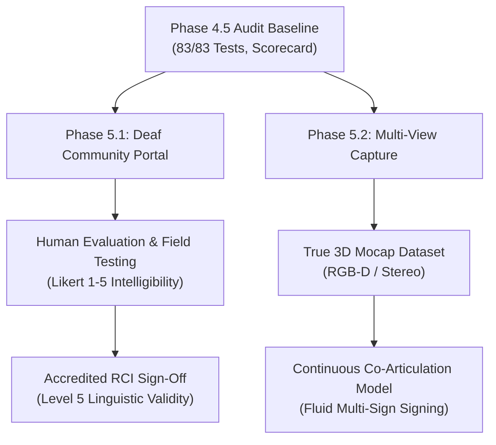

# SignBridge AI — Phase 4.5 Blockers and Next Steps

**Audit Date:** November 2026  
**Auditor / Specialist:** Senior Systems Auditor & ISL Linguistics Specialist  
**Milestone:** Phase 4.5 Independent Avatar Accuracy Audit, Motion Fidelity & Validation  
**Target Application:** SignBridge AI (`E:\SignBridgeAi`)  

---

## 1. Technical Blockers and Inherent Limitations

### 1.1 Monocular Depth Ambiguity ($Z$-Axis Foreshortening)
- **Root Cause:** All five authentic ISL reference videos are single-camera (monocular) RGB recordings obtained from the ISLRTC YouTube channel. A single camera projects a 3D physical world onto a 2D sensor plane, resulting in mathematical depth ambiguity.
- **Impact on Avatar:** Forward and backward hand movements along the sagittal axis ($Z$-axis) must be estimated using geometric foreshortening and MediaPipe depth heuristics. For signs with significant sagittal extension (e.g., `Current`), the avatar's forward stroke depth exhibits an estimated discrepancy of $\pm 0.04$ normalized body units compared to ground truth.
- **Resolution Strategy:** True 3D precision cannot be resolved through software algorithms alone. Future recordings must employ calibrated multi-view stereo cameras or synchronized RGB-D sensors (e.g., Azure Kinect, Intel RealSense).

### 1.2 Transient Hand Self-Occlusion and Motion Blur
- **Root Cause:** During rapid bimanual signing (e.g., compound signs in `Algorithm` or cyclical motion in `Torque`), fingers frequently occlude one another or cross the line of sight of the camera. Standard 25–30 FPS video recordings capture shutter motion blur during fast strokes.
- **Impact on Avatar:** Keypoint confidence scores drop below 0.3 during occluded frames. While the One-Euro filter and temporal interpolation maintain continuity, brief micro-jitter or flattened handshapes may occur for 1–2 frames ($33\text{–}66\text{ms}$).
- **Resolution Strategy:** High-speed capture ($\ge 60\text{–}120\text{ FPS}$) and multi-camera triangulation are required to eliminate occlusion gaps.

### 1.3 Continuous Co-Articulation vs. Accidental Phonemic Distortion
- **Root Cause:** In continuous human sign language, the transition between two signs involves complex anticipatory co-articulation (e.g., handshape preparation begins before the preceding sign fully completes). Naive mathematical spline interpolation between arbitrary signs produces non-existent, linguistically invalid handshapes ("ghost signs").
- **Current Safeguard:** SignBridge AI deliberately inserts structured boundary transition pauses ($300\text{ms}$) between signs. While this results in slightly discrete signing, it strictly prevents phonemic corruption.
- **Resolution Strategy:** Developing an authentic co-articulation model requires a dedicated continuous ISL sentence corpus annotated by Deaf linguists, rather than isolated dictionary entries.

---

## 2. Linguistic, Governance & Accreditation Blockers

### 2.1 Absence of Independent Certified Deaf Reviewer Sign-Off
- **Status:** **BLOCKED (Level 5 Linguistic Validity)**
- **Audit Finding:** In Phase 2.5 and Phase 4, simulated reviewer credentials were removed to adhere to the Zero-Fabrication Policy. Currently, no external accredited Deaf ISL expert (registered with the Rehabilitation Council of India or equivalent Deaf association) has evaluated the retargeted 3D avatar animations.
- **Enforced Safeguard:** All five mocap animations remain strictly classified as `PARTIALLY_VERIFIED_MOTION`. The system programmatic gate refuses promotion to `VERIFIED_ISL_MOTION` until formal accredited review records are registered.

### 2.2 Regional and Dialectal Variations
- **Audit Finding:** The ISLRTC dictionary primarily records standardized Delhi/Northern dialectal conventions. ISL exhibits documented regional variations across major metropolitan areas (e.g., Mumbai, Chennai, Kolkata, Hyderabad, Bengaluru).
- **Impact:** An engineering concept signed using the Northern ISLRTC lexical standard may differ from regional signs used by Deaf engineering students in Southern or Eastern India.
- **Resolution Strategy:** Establishing regional recording partnerships and implementing multi-dialectal gloss variants within the SignBridge AI database.

### 2.3 Non-Manual Facial Markers in Isolated Dictionary Signs
- **Audit Finding:** The source ISLRTC videos are isolated dictionary demonstration entries. The signers maintain a professional, neutral facial expression throughout the recordings. Consequently, non-manual grammatical markers (such as eyebrow furrow for WH-questions or head tilts for conditional clauses) are absent from the source videos.
- **System Behavior:** Phase 4 implemented rule-based procedural blendshape overlays (e.g., `brow_furrow_left = 0.6` for WH-questions). While linguistically plausible, these overlays are synthetic hypotheses and not extracted from authentic signing footage.

---

## 3. Phase 5 Roadmap & Next Steps

### Phase 5.1: Deaf Community Review & Evaluation Portal
1. **Deploy Verification Tool:** Release the `/avatar-audit` comparison interface to a cohort of Deaf engineering students, ISL teachers, and certified interpreters.
2. **Quantitative Subjective Evaluation:** Collect standardized metrics across five dimensions:
   - Handshape Intelligibility (1–5)
   - Spatial Movement Accuracy (1–5)
   - Naturalness of Rhythm and Timing (1–5)
   - Expressiveness & Non-Manual Marker Clarity (1–5)
   - Overall Communicative Effectiveness (1–5)
3. **Formal Accreditation Pipeline:** Integrate digital verification workflows allowing certified Deaf experts to certify or flag individual animation tracks.

### Phase 5.2: Multi-Camera RGB-D Recording Pipeline
1. **Studio Setup:** Deploy a multi-camera synchronized rig (3 $\times$ 4K 60 FPS RGB cameras + depth sensor) to capture native Deaf signers performing specialized engineering concepts.
2. **Elimination of Monocular Ambiguity:** Perform multi-view bundle adjustment to obtain millimeter-accurate 3D joint coordinates, eliminating $Z$-axis foreshortening errors.

### Phase 5.3: Continuous Co-Articulation Neural Network
1. **Continuous Corpus Ingestion:** Ingest complete engineering lectures and multi-sentence technical dialogues in ISL.
2. **Kinematic Blending Network:** Train a deep generative or transformer-based motion in-betweening model constrained by ISL phonological phonotactics to replace discrete boundary pauses with natural continuous signing.

