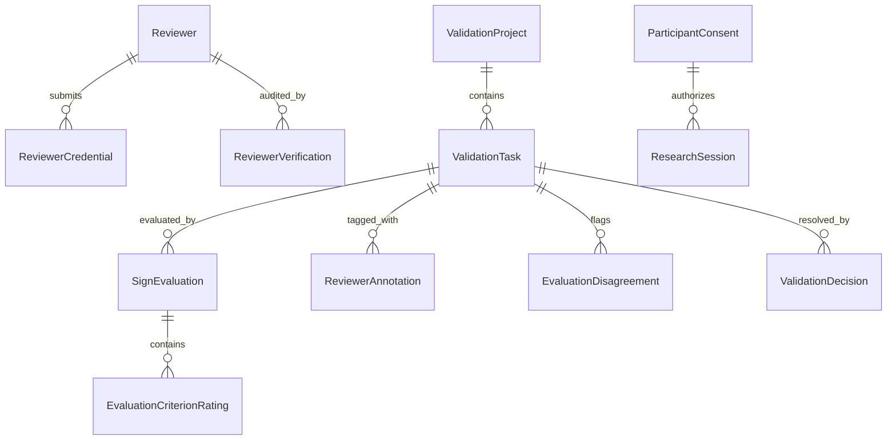

# SignBridge AI — Phase 5.3: Database Models & REST API Reference

**Author:** Senior Backend Engineer & Database Architect  
**Milestone:** Phase 5 — ISL Community Review, Expert Validation & Academic Evaluation Framework  
**Project:** SignBridge AI (`E:\SignBridgeAi`)  

---

## 1. Relational Database Schema (`backend/app/models/validation_models.py`)

SignBridge AI utilizes SQLAlchemy ORM with a modular table design ensuring zero regression with prior Phase 1–4 tables while providing full relational integrity for validation and community research.

### Table Specifications:

1. **`phase5_reviewers`**:
   - `id` (PK, Integer), `username` (Unique, String(100)), `email` (Unique, String(150)), `hashed_password` (String(255))
   - `full_name` (String(150)), `is_deaf_native_signer` (Boolean), `is_certified_interpreter` (Boolean)
   - `years_of_experience` (Integer), `institution_affiliation` (String(200))
   - `role` (Enum: `reviewer`, `expert_reviewer`, `deaf_native_signer`, `certified_interpreter`, `admin`, `community_participant`)
   - `verification_status` (Enum: `unverified`, `verification_pending`, `verified`, `rejected`, `suspended`)
   - `is_active` (Boolean), `created_at` (DateTime)

2. **`phase5_reviewer_credentials`**:
   - `id` (PK, Integer), `reviewer_id` (FK -> `phase5_reviewers.id`), `credential_type` (Enum)
   - `credential_identifier` (String(150)), `issuing_body` (String(200)), `issue_date` (DateTime), `expiry_date` (DateTime)
   - `document_url` (String(255)), `verification_status` (Enum), `notes` (Text), `created_at` (DateTime)

3. **`phase5_reviewer_verifications`**:
   - `id` (PK, Integer), `reviewer_id` (FK -> `phase5_reviewers.id`), `admin_id` (FK -> `phase5_reviewers.id`)
   - `previous_status` (Enum), `new_status` (Enum), `rationale` (Text), `evidence_verified` (Boolean), `verified_at` (DateTime)

4. **`phase5_validation_projects`**:
   - `id` (PK, Integer), `name` (String(200)), `description` (Text), `target_domain` (String(100)), `rubric_config_json` (Text), `is_active` (Boolean)

5. **`phase5_validation_tasks`**:
   - `id` (PK, Integer), `project_id` (FK -> `phase5_validation_projects.id`), `sign_record_id` (FK -> `sign_records.id`), `concept_id` (FK -> `concepts.id`)
   - `status` (Enum: `unreviewed`, `pending_review`, `under_review`, `reviewed`, `disagreement_detected`, `adjudication_required`, `accepted`, `rejected`, `inconclusive`)
   - `assigned_reviewers_count` (Integer), `completed_reviews_count` (Integer), `created_at` (DateTime), `updated_at` (DateTime)

6. **`phase5_sign_evaluations`**:
   - `id` (PK, Integer), `task_id` (FK -> `phase5_validation_tasks.id`), `reviewer_id` (FK -> `phase5_reviewers.id`), `sign_record_id` (FK -> `sign_records.id`)
   - `is_draft` (Boolean), `overall_recommendation` (String(50)), `general_feedback` (Text), `suggested_dialect` (String(100)), `submitted_at` (DateTime)

7. **`phase5_evaluation_criteria_ratings`**:
   - `id` (PK, Integer), `evaluation_id` (FK -> `phase5_sign_evaluations.id`), `criterion_name` (String(100))
   - `rating` (Enum: `pass`, `minor_issue`, `major_issue`, `incorrect`, `not_applicable`, `unable_to_assess`)
   - `notes` (Text), `is_critical_error` (Boolean)

8. **`phase5_reviewer_annotations`**:
   - `id` (PK, Integer), `task_id` (FK -> `phase5_validation_tasks.id`), `reviewer_id` (FK -> `phase5_reviewers.id`)
   - `timestamp_ms` (Integer), `duration_ms` (Integer), `target_type` (String(50)), `category` (String(100)), `comment` (Text)

9. **`phase5_evaluation_disagreements`**:
   - `id` (PK, Integer), `task_id` (FK -> `phase5_validation_tasks.id`), `criterion_name` (String(100))
   - `disagreement_type` (String(100)), `reviewer_ratings_json` (Text), `status` (String(50)), `detected_at` (DateTime)

10. **`phase5_validation_decisions`**:
    - `id` (PK, Integer), `task_id` (FK -> `phase5_validation_tasks.id`), `adjudicator_id` (FK -> `phase5_reviewers.id`)
    - `decision` (Enum: `accepted`, `rejected`, `inconclusive`, `additional_review_required`)
    - `resulting_motion_status` (String(50)), `rationale` (Text), `evidence_summary` (Text), `decided_at` (DateTime)

11. **`phase5_participant_consents`**:
    - `id` (PK, Integer), `pseudonym` (Unique, String(100)), `study_name` (String(200)), `consent_version` (String(50))
    - `consent_given` (Boolean), `can_withdraw_anytime` (Boolean), `data_deletion_requested` (Boolean), `consent_date` (DateTime), `withdrawal_date` (DateTime)

12. **`phase5_research_sessions`**:
    - `id` (PK, Integer), `consent_id` (FK -> `phase5_participant_consents.id`), `session_code` (Unique, String(100))
    - `session_type` (String(100)), `concepts_tested_json` (Text), `comprehension_score` (Float), `naturalness_rating` (Float), `feedback_notes` (Text)

13. **`phase5_validation_audit_logs`**:
    - `id` (PK, Integer), `actor_id` (Integer), `actor_username` (String(100)), `action` (String(100))
    - `target_type` (String(100)), `target_id` (String(100)), `details_json` (Text), `timestamp` (DateTime)

---

## 2. REST API Reference

All endpoints are hosted under `/api/v1/`:

### 2.1 Reviewer & Credential Endpoints
- **`POST /api/v1/validation/register`**: Registers candidate reviewer account (Status: `UNVERIFIED`).
- **`POST /api/v1/validation/login`**: Authenticates reviewer, returns cryptographically signed Bearer token.
- **`GET /api/v1/validation/me`**: Returns profile of authenticated reviewer.
- **`POST /api/v1/validation/credentials`**: Submits credentials; updates status to `VERIFICATION_PENDING`.
- **`GET /api/v1/validation/credentials/pending`**: Admin view of pending credentials.
- **`POST /api/v1/validation/credentials/{id}/verify`**: Admin approval/rejection of credentials.

### 2.2 Validation Task & Evaluation Endpoints
- **`GET /api/v1/validation/tasks`**: Lists validation queue with optional status filter.
- **`GET /api/v1/validation/tasks/{id}`**: Returns comprehensive task package (concept, sign, video, avatar, annotations, disagreements).
- **`POST /api/v1/validation/tasks/{id}/evaluate`**: Submits structured 12-criterion rubric. Enforces critical error locks and triggers automated disagreement detection.
- **`POST /api/v1/validation/tasks/{id}/annotations`**: Appends timestamped video/avatar annotation.
- **`POST /api/v1/validation/tasks/{id}/adjudicate`**: Binding administrative resolution of conflicting reviews. Requires `VERIFIED` reviewer role.

### 2.3 Dashboard & Academic Statistics
- **`GET /api/v1/validation/dashboard`**: Live metrics for tasks, reviews, and technical vs. linguistic status.
- **`GET /api/v1/validation/academic-metrics`**: Inter-rater reliability (Cohen's Kappa, Fleiss' Kappa), Wilson score confidence intervals, and criterion-level agreement.
- **`GET /api/v1/validation/audit-logs`**: Immutable audit log of all validation events.

### 2.4 Deaf Community Research Endpoints
- **`POST /api/v1/community/consent`**: Registers participant informed consent under a pseudonym.
- **`GET /api/v1/community/consent/{pseudonym}`**: Checks active consent status.
- **`POST /api/v1/community/sessions`**: Records comprehension survey score or naturalness rating.
- **`POST /api/v1/community/delete-data`**: GDPR/ethical right to be forgotten: permanently purges all session records for a pseudonym.
- **`GET /api/v1/community/export`**: Exports anonymized research dataset under Open Data Commons (ODC-By).

