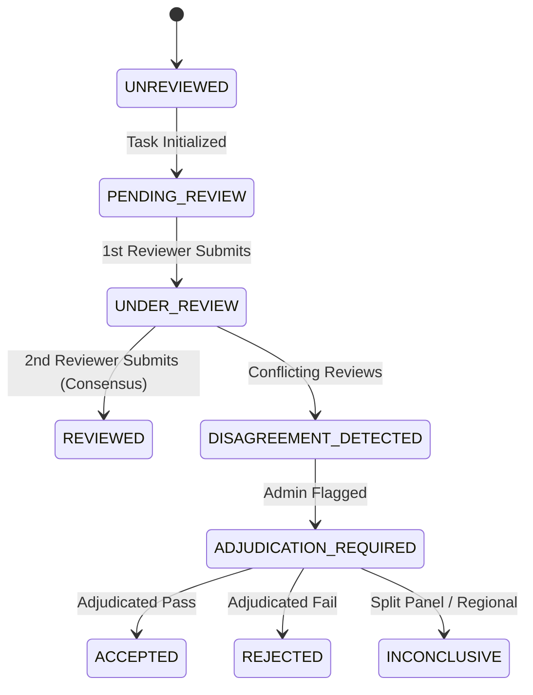

# SignBridge AI — Phase 5.4: Validation Workflow & Lifecycle

**Author:** Senior ISL Systems Auditor & Workflow Engineer  
**Milestone:** Phase 5 — ISL Community Review, Expert Validation & Academic Evaluation Framework  
**Project:** SignBridge AI (`E:\SignBridgeAi`)  

---

## 1. Multi-Stage Validation Lifecycle

Validation in SignBridge AI transitions through a formal state machine:

### Stage Definitions:
1. **`UNREVIEWED`**: Ingested candidate sign without an initialized validation task.
2. **`PENDING_REVIEW`**: Initialized validation task waiting for expert reviewers to open the case.
3. **`UNDER_REVIEW`**: One expert reviewer has submitted an evaluation; awaiting second independent evaluation to verify inter-rater consensus.
4. **`REVIEWED`**: Multiple independent expert evaluations submitted with congruent ratings.
5. **`DISAGREEMENT_DETECTED`**: Automated algorithm detects rating divergence (e.g., one reviewer passes handshape while another flags a major phonological issue).
6. **`ADJUDICATION_REQUIRED`**: Task placed on the administrative docket for panel review.
7. **`ACCEPTED`**: Officially certified as an authentic, representative ISL sign.
8. **`REJECTED`**: Formally disqualified due to phonemic corruption, wrong vocabulary, or illegality in ISL phonotactics.
9. **`INCONCLUSIVE`**: Split expert opinion or unresolved dialectal variation requiring broader regional field studies.

---

## 2. Automated Disagreement Detection Algorithm

SignBridge AI executes automated disagreement scans whenever a new evaluation is submitted on an existing task:

### 2.1 Recommendation Conflict:
- If Reviewer A recommends `ACCEPT` and Reviewer B recommends `REJECT` or `NEEDS_REVISION`.
- Creates an `EvaluationDisagreement` record with `disagreement_type="recommendation_conflict"`.

### 2.2 Phonological Criterion Divergence:
- For each of the 12 criteria, ratings from all reviewers are aggregated.
- A conflict is flagged if one reviewer marks `PASS` while another marks `MAJOR_ISSUE` or `INCORRECT`.
- Creates an `EvaluationDisagreement` record with `disagreement_type="rating_conflict"` specifying the exact criterion (e.g., `handshape`, `movement`, `orientation`).

### 2.3 Automatic Status Escalation:
- If any disagreement is recorded, the task status is immediately transitioned to **`DISAGREEMENT_DETECTED`**.
- The task is highlighted with red warning banners in the Reviewer Portal and Dashboard.

---

## 3. Binding Adjudication Workflow

Disagreements cannot be resolved through automated statistical averaging. Human linguistic divergence requires qualified administrative adjudication:

1. **Adjudicator Qualification Gate:**
   - Only reviewers with **`role="admin"`** and **`verification_status="verified"`** are authorized to adjudicate.
   - Unverified accounts attempting adjudication receive an HTTP 403 Forbidden error.
2. **Adjudication Evidence Requirements:**
   - Adjudicators must review both reviewers' annotations, source video timestamps, and phonological notes.
   - Adjudication requires a mandatory written **`rationale`** (minimum 10 characters) and documented **`evidence_summary`**.
3. **Resolution Outcomes:**
   - **`ACCEPTED`**: Adjudicator confirms linguistic validity; underlying `SignRecord` is marked `VERIFIED`.
   - **`REJECTED`**: Adjudicator upholds phonological critique; `SignRecord` marked `UNSUPPORTED`.
   - **`ADDITIONAL_REVIEW_REQUIRED`**: Adjudicator refers sign to external Deaf linguistics committee; task reset to `PENDING_REVIEW`.

---

## 4. Zero-Fabrication Safeguard Enforced

### Absolute Invariance Rules:
1. **No Automated Promotion:** No machine learning confidence score, 3D landmark NMLE metric, or test pass count can transition an asset from `PARTIALLY_VERIFIED_MOTION` to `VERIFIED_ISL_MOTION`.
2. **No Promotion via Unverified Reviewers:** Candidate reviewer evaluations remain advisory; status promotion strictly requires verified credentials.
3. **Current Status Retained:** All five existing mocap assets (`Algorithm`, `Frequency`, `Current`, `Beam`, `Torque`) remain strictly **`PARTIALLY_VERIFIED_MOTION`** and **`PENDING_REVIEW`**, truthfully reflecting the pending nature of external accredited evaluation.
