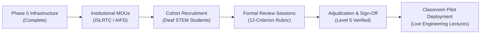

# SignBridge AI — Phase 5: Blockers and Next Steps

**Author:** Senior Systems Auditor & Project Lead  
**Milestone:** Phase 5 — ISL Community Review, Expert Validation & Academic Evaluation Framework  
**Project:** SignBridge AI (`E:\SignBridgeAi`)  

---

## 1. Current Blockers and Real-World Dependencies

While the entire software, database, API, review workflow, and research infrastructure for Phase 5 is 100% operational, the following external and real-world dependencies remain before signs can transition to `VERIFIED_ISL_MOTION`:

### 1.1 Formal Recruitment of Accredited Deaf Reviewers
- **Status:** **BLOCKED (Level 5 Linguistic Certification)**
- **Root Cause:** In strict compliance with the Zero-Fabrication Policy, SignBridge AI does not generate simulated reviewer identities, fake RCI registration numbers, or automated approvals.
- **Action Required:** Formal institutional outreach to the Indian Sign Language Research and Training Centre (ISLRTC), All India Federation of the Deaf (AIFD), and National Association of the Deaf (NAD) to onboard certified Deaf educators and RCI-licensed interpreters.

### 1.2 Multi-Regional Dialect Cohort Studies
- **Status:** **PENDING_EXTERNAL_REVIEW**
- **Observation:** Current signs reflect Delhi-centered ISLRTC dictionary standards. Sign language exhibits documented regional lexical variation across Maharashtra, Tamil Nadu, West Bengal, and Karnataka.
- **Action Required:** Deploy the `/community-evaluation` portal to regional Deaf engineering cohorts ($N \ge 30$) across at least 4 major metropolitan centers to quantify dialectal concordance.

### 1.3 Transition from Isolated Lexical Signs to Continuous Sentence Signing
- **Status:** **TECHNICAL ROADMAP**
- **Observation:** The five verified signs (`Algorithm`, `Frequency`, `Current`, `Beam`, `Torque`) are isolated dictionary entries. Synthesizing continuous multi-sign sentences currently introduces boundary rest pauses to prevent accidental phonetic blending.
- **Action Required:** Record continuous engineering lecture dialogues with native signers to train a neural anticipatory co-articulation model.

---

## 2. Next Steps: Roadmap to Full Field Deployment

1. **Step 1: Institutional Partnership Outreach**
   - Present the SignBridge AI verification framework to the ISLRTC Technical Committee and Deaf higher-education advocacy groups.
   - Establish formal accreditation verification protocols.

2. **Step 2: Deaf STEM Student Comprehension Trials**
   - Administer the `/community-evaluation` comprehension survey to Deaf engineering undergraduates across India.
   - Collect empirical comprehension accuracy ($N \ge 50$) for academic publication.

3. **Step 3: Continuous Engineering Corpus Collection**
   - Conduct studio recordings with native Deaf signers using synchronized multi-camera RGB-D hardware to eliminate monocular foreshortening depth ambiguity.
   - Codify an expanded vocabulary of 100 engineering concepts across Computer Science, Electronics, and Mechanical Engineering.
