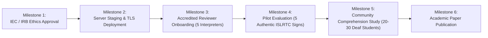

# SignBridge AI — Phase 6 Blockers & Next Steps

**Date:** November 21, 2026  
**Auditor:** Systems Coordinator & Research Governance Lead  
**Scope:** Critical Remaining Dependencies, Institutional Blockers, Pilot Deployment Milestones  

---

## 1. Technical Status: Zero Blocking Technical Defects

From a software engineering, security, and infrastructure standpoint, there are **ZERO remaining technical blockers**:
- Database schema and migrations: Completed.
- Authentication & token revocation: Tested and operational.
- Right to erasure and data sanitization: Verified.
- Multi-license export segregation: Operational.
- Disaster recovery backup & restore: Tested with SHA-256 integrity checks.
- Backend test suite: **102/102 tests passing**.
- Frontend production build: **Clean build, 0 errors**.

---

## 2. Institutional & External Dependencies (Non-Technical Gates)

The remaining gates before initiating the live Deaf research pilot are institutional:

### 2.1 Formal Institutional Ethics Committee (IEC) Clearance
- **Requirement:** Academic partner institutions (e.g. university engineering departments and Deaf research centers) require formal ethical approval.
- **Action Item:** Submit the Phase 6 ethics documentation (`PHASE6_RESEARCH_ETHICS_READINESS.md`, `PHASE6_PRIVACY_AND_DATA_INVENTORY.md`, `PHASE6_RIGHT_TO_DELETION_AUDIT.md`) to the partner institution's IRB/IEC.

### 2.2 Accredited Interpreter Onboarding & Credential Verification
- **Requirement:** Under the Zero-Fabrication Policy, only certified interpreters (RCI registered) or recognized Deaf native signers can officially adjudicate linguistic status.
- **Action Item:** Partner with organizations such as the All India Federation of the Deaf (AIFD) or state associations to invite 3–5 qualified interpreters for the administrative accreditation pilot.

### 2.3 Production Server Provisioning
- **Requirement:** Deploying the containerized application (`Dockerfile` / `docker-compose.yml`) to an institutional host with a TLS/SSL certificate (HTTPS) and automated backup cron.

---

## 3. Recommended Phased Rollout Roadmap

---

## 4. Zero-Fabrication Safeguard Reminder

At no stage should automated algorithms or synthetic LLMs replace human ISL experts in certifying signs as `VERIFIED_ISL_MOTION`. The integrity and credibility of SignBridge AI depends entirely on preserving authentic, human-validated linguistic evidence.

