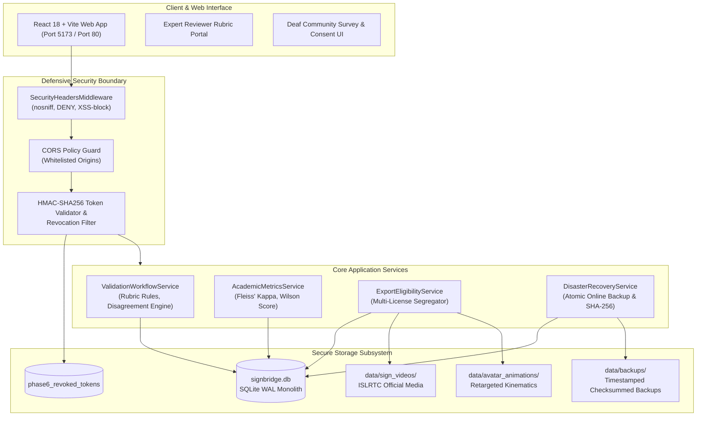

# SignBridge AI — Phase 6 Data Flow Architecture

**Date:** November 21, 2026  
**Auditor:** Systems Architect  
**Scope:** Ingestion Pipeline, Evaluation Inflow, Data Storage, Export Pathways, Network Boundaries  
**Status:** VERIFIED & HARDENED  

---

## 1. Architectural Overview

SignBridge AI operates as a unified modular monolith designed for secure local evaluation and low-latency academic collaboration without cloud vendor lock-in.

---

## 2. Inflow Pipelines

### 2.1 Expert Review Inflow
1. Reviewer authenticates via `POST /api/v1/validation/login`.
2. Token signature is verified and confirmed not present in `phase6_revoked_tokens`.
3. Reviewer submits 12-criterion rubric evaluation via `POST /api/v1/validation/tasks/{id}/evaluate`.
4. Reviewer ID is bound from authenticated session; critical error checks are evaluated.
5. If multiple reviews conflict, an `EvaluationDisagreement` is automatically registered.
6. Action is logged to immutable audit trail.

### 2.2 Community Survey Inflow
1. Deaf participant completes informed consent on `POST /api/v1/community/consent` under a pseudonym.
2. Consent booleans (`general_research`, `video_recording`, `data_sharing`, `academic_publication`) are stored.
3. Participant submits comprehension response via `POST /api/v1/community/sessions`.
4. System validates that participant has active, non-withdrawn consent before recording.

---

## 3. Outflow Pipelines & Export Quarantine

1. When `GET /api/v1/community/export` is queried:
   - Query routes through `ExportEligibilityService`.
   - Participants with `data_deletion_requested == True` or `is_anonymized == True` are quarantined and omitted.
   - Participants with `consent_data_sharing == False` are quarantined and omitted.
   - Outputs are strictly partitioned into three independent licensed envelopes:
     * `community_evaluations` under `ODC-By`
     * `retargeted_mocap` under `CC-BY-4.0`
     * `islrtc_reference_metadata` under `GODL-India` (metadata pointers only, no raw file transfers).
