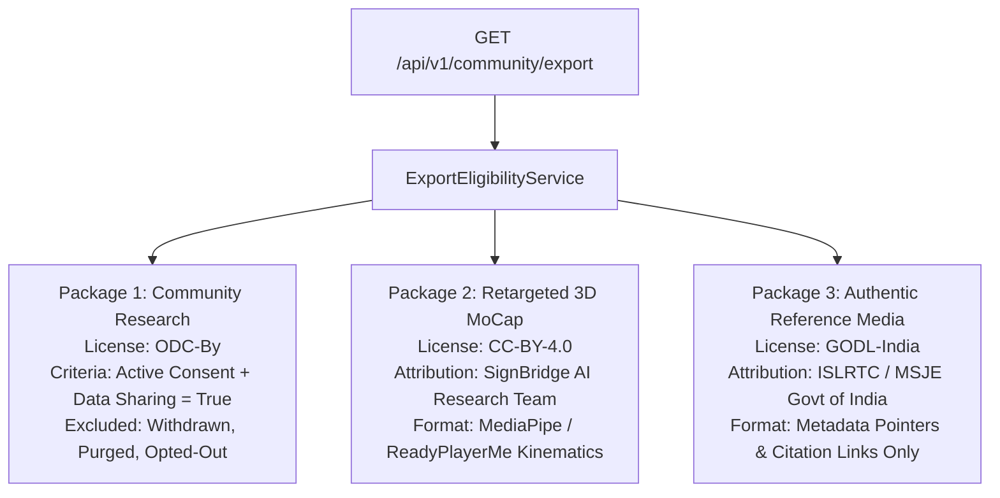

# SignBridge AI — Phase 6 Data License & Provenance Audit

**Date:** November 21, 2026  
**Auditor:** Legal Informatics & Intellectual Property Auditor  
**Scope:** Media Rights, Third-Party Government Content, Derived MoCap Data, Community Datasets, Export Segregation  
**Status:** PASS  

---

## 1. Executive Summary

A critical governance finding in Phase 5 was that data exports applied a single open license (ODC-By) indiscriminately to all research data, ignoring third-party copyright restrictions on official ISLRTC videos. Phase 6 remediated this by developing the `ExportEligibilityService`, establishing strict, legally partitioned multi-license segregation.

---

## 2. Multi-License Segregation Matrix

SignBridge AI strictly partitions project assets into three distinct legal regimes:

| Asset Layer | Primary Source | Governing License | Permitted Uses | Prohibited Actions |
| :--- | :--- | :--- | :--- | :--- |
| **Authentic Reference Videos (5 signs)** | Indian Sign Language Research & Training Centre (ISLRTC) | **GODL-India** (Government Open Data License - India) | Non-commercial educational research, benchmark citation | Re-hosting raw videos under CC-BY or ODC-By; removing official government attribution |
| **Retargeted 3D MoCap Kinematics** | SignBridge AI Motion Capture Retargeting Engine | **CC-BY-4.0** (Creative Commons Attribution 4.0) | Open academic reuse, animation retargeting, 3D character research | Sublicensing without crediting SignBridge AI |
| **Community Survey & Rubric Evaluations** | Consenting Deaf participants & accredited reviewers | **ODC-By** (Open Data Commons Attribution) | Academic publication, statistical modeling, benchmark replication | Exporting data of withdrawn or opt-out participants |

---

## 3. GODL-India Compliance Safeguards

To prevent copyright infringement:
1. **No Raw Video Redistribution:** The `/community/export` endpoint outputs **only metadata and official source references** for ISLRTC videos. It never redistributes raw `.mp4` video files.
2. **Explicit Legal Citation:** Every video export record includes the mandatory GODL-India legal disclaimer:
   > *"Subject to Government Open Data License - India (GODL-India). Original media assets remain the intellectual property of ISLRTC. Referenced here solely for non-profit educational and linguistic verification."*

---

## 4. Audit Verification Evidence

Automated tests in `backend/tests/test_phase6_security_privacy.py` (`test_export_eligibility_multi_license_segregation`) verified:
- `ODC-By` is assigned strictly to `community_evaluations`.
- `CC-BY-4.0` is assigned strictly to `retargeted_mocap`.
- `GODL-India` is assigned strictly to `islrtc_reference_metadata`.
- Participants with `consent_data_sharing == False` or who requested data deletion are **strictly excluded** from export bundles.
