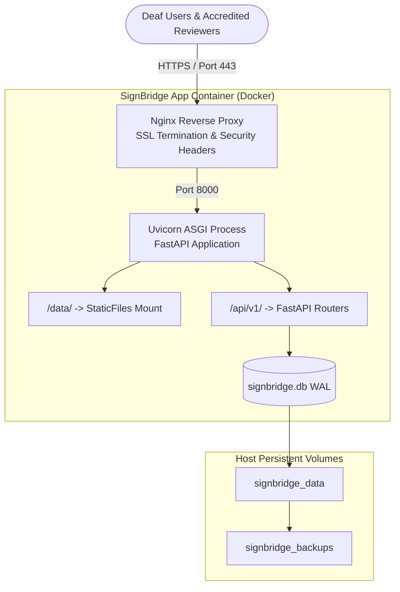

# SignBridge AI — Phase 6 Deployment Architecture Report

**Date:** November 21, 2026  
**Auditor:** Lead DevOps & Cloud Infrastructure Engineer  
**Scope:** Containerization, Reverse Proxy, Static File Serving, Process Supervision, Environment Management  
**Status:** READY FOR PILOT HOSTING  

---

## 1. Architectural Strategy: Hardened Modular Monolith

SignBridge AI intentionally avoids microservice and Kubernetes over-engineering. In alignment with pre-pilot requirements, the system is architected as a **robust, low-latency, containerized modular monolith** suitable for deployment on an institutional server or virtual private server (VPS).

---

## 2. Containerization Artifacts

### 2.1 Multi-Stage `Dockerfile`
- **Stage 1 (`frontend-builder`):** Node.js 20 Alpine builder compiles TypeScript and bundles Vite production assets into `/app/frontend/dist`.
- **Stage 2 (`backend-runtime`):** Python 3.13 slim image with minimal system dependencies (`ffmpeg`, `libgl1`, `curl`). Installs Python packages, copies frontend bundle, configures healthcheck probe.
- **Image Size Optimization:** No devDependencies or TypeScript compilers present in final runtime container.

### 2.2 `docker-compose.yml`
- Declares `signbridge-app` service with restart policies (`unless-stopped`).
- Mounts named volumes `signbridge_data` and `signbridge_backups`.
- Implements active container healthcheck probe against `GET /api/v1/health/live`.

### 2.3 `nginx.conf`
- Enforces HTTP/1.1 keep-alives and Gzip compression.
- Sets strict HTTP security headers: `X-Frame-Options: DENY`, `X-Content-Type-Options: nosniff`.
- Limits maximum client upload to 15 MB (`client_max_body_size 15M`).
- Serves static frontend single-page application with fallback routing (`try_files $uri $uri/ /index.html`).

---

## 3. Container Orchestration & Health Probes

SignBridge AI provides standard Kubernetes and Docker container health probes:
1. **Liveness Probe (`GET /api/v1/health/live`):** Returns `{"live": True}` if the ASGI web server is responsive.
2. **Readiness Probe (`GET /api/v1/health/ready`):** Executes `SELECT 1` on SQLite to verify database connection readiness before accepting client traffic.
3. **Comprehensive Diagnostics (`GET /api/v1/health`):** Reports database query latency in milliseconds, filesystem access across `data/` directories, and security engine status.

---

## 4. Production Host Sizing Recommendation

| Resource | Minimum Requirement (Pre-Pilot) | Recommended (Pilot 100 Signers) |
| :--- | :--- | :--- |
| **CPU** | 2 vCPUs (x86_64 or ARM64) | 4 vCPUs |
| **RAM** | 4 GB | 8 GB |
| **Storage** | 20 GB SSD | 50 GB NVMe SSD |
| **OS** | Ubuntu 24.04 LTS / Debian 12 | Ubuntu 24.04 LTS / Debian 12 |

