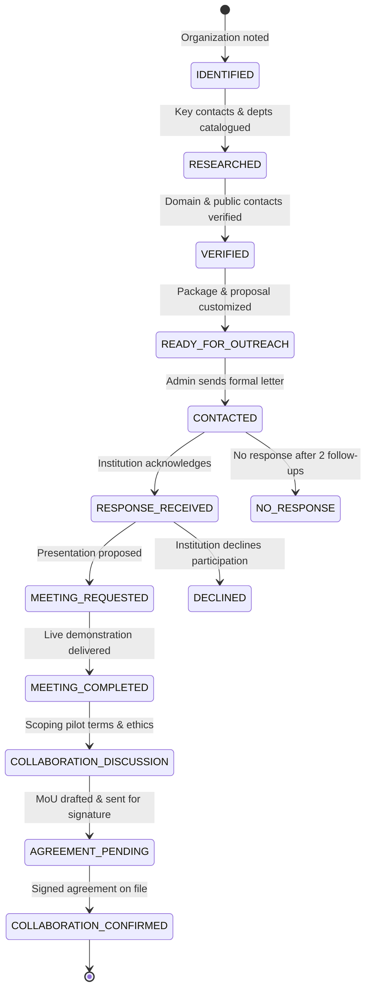

# SIGNBRIDGE AI — PHASE 8.4: INSTITUTIONAL OUTREACH MANAGEMENT SYSTEM SPECIFICATION & AUDIT

**Phase:** Phase 8 — Institutional Outreach, Live Demonstration, External ISL Expert Recruitment & Collaboration Readiness  
**Subsystem:** Institutional Outreach & Collaboration Management Module (`/api/v1/outreach`)  
**Status:** IMPLEMENTED & TESTED  
**Date:** 2026-11-23  

---

## 1. Executive Summary & Purpose

The Institutional Outreach Management System provides an internal administrative and research tracking framework to manage prospective institutional partnerships, researcher inquiries, live presentation workflows, and MoUs across academic, government, Deaf community, and clinical institutions in India.

In accordance with SignBridge AI's **Zero-Fabrication Policy**, this system is purely an **internal management and audit-tracking tool**. It does **not** autonomously dispatch unsolicited emails, submit contact forms, or claim unconfirmed affiliations. All external communications require direct human administrative initiation and authorization.

---

## 2. Data Architecture & Relational Schema

The outreach module consists of two relational tables residing in the SignBridge SQLite datastore (`signbridge.db`):

### 2.1 Table: `phase8_institutional_outreach`

| Column | Type | Constraints | Description |
| :--- | :--- | :--- | :--- |
| `id` | INTEGER | PRIMARY KEY | Unique entity identifier |
| `organization_name` | VARCHAR(200) | UNIQUE, NOT NULL | Full official institutional name |
| `acronym` | VARCHAR(50) | NULLABLE | Standard institutional acronym (e.g., ISLRTC, AYJNISHD) |
| `category` | ENUM | NOT NULL | `GOVERNMENT_NATIONAL`, `DEAF_ORGANIZATION`, `ACADEMIC_RESEARCH`, `SPECIAL_EDUCATION`, `DISABILITY_CENTER`, `OTHER` |
| `website` | VARCHAR(255) | NOT NULL | Official verified domain |
| `public_contact` | VARCHAR(255) | NOT NULL | Authoritative public email or contact portal |
| `telephone` | VARCHAR(100) | NULLABLE | Published institutional telephone contact |
| `department` | VARCHAR(200) | NULLABLE | Relevant academic/research department |
| `contact_person` | VARCHAR(150) | NULLABLE | Primary designated liaison or department head |
| `designation` | VARCHAR(150) | NULLABLE | Official designation of contact person |
| `verification_source`| VARCHAR(255) | NOT NULL | Documented provenance of institutional validity |
| `verification_date` | VARCHAR(50) | NOT NULL | ISO date when contact and domain were verified |
| `collaboration_role` | VARCHAR(200) | NOT NULL | Primary expertise role (e.g. Lexicography, Kinematics, Pilot Hosting) |
| `outreach_status` | ENUM | NOT NULL | Lifecycle stage (see Section 3) |
| `proposed_collaboration_tier` | VARCHAR(100) | NOT NULL | Tier 1 (Validation), Tier 2 (Co-Design), Tier 3 (Classroom Pilot) |
| `follow_up_date` | DATETIME | NULLABLE | Scheduled date for next human follow-up |
| `notes` | TEXT | NULLABLE | Internal researcher notes and context |
| `created_at` | DATETIME | DEFAULT UTC | Record creation timestamp |
| `updated_at` | DATETIME | DEFAULT UTC | Record last update timestamp |

### 2.2 Table: `phase8_outreach_interactions`

| Column | Type | Constraints | Description |
| :--- | :--- | :--- | :--- |
| `id` | INTEGER | PRIMARY KEY | Unique interaction log entry |
| `outreach_id` | INTEGER | FK -> outreach.id | Referenced institution |
| `interaction_type` | ENUM | NOT NULL | `EMAIL_SENT`, `EMAIL_RECEIVED`, `PHONE_CALL`, `VIRTUAL_MEETING`, `IN_PERSON_MEETING`, `PRESENTATION`, `MOU_DRAFT`, `NOTE` |
| `summary` | VARCHAR(255) | NOT NULL | High-level summary of interaction |
| `details` | TEXT | NULLABLE | Detailed discussion points or agenda |
| `outcome` | VARCHAR(255) | NULLABLE | Formal outcome of interaction |
| `next_steps` | VARCHAR(255) | NULLABLE | Actionable next steps |
| `logged_by_id` | INTEGER | FK -> reviewer.id | User ID of researcher who logged entry |
| `logged_by_name` | VARCHAR(150) | NULLABLE | Name of researcher |
| `timestamp` | DATETIME | DEFAULT UTC | Interaction timestamp |

---

## 3. Outreach Lifecycle State Machine

### Automatic Lifecycle Transitions
When human researchers log specific interaction types, the backend automatically transitions the institutional status:
1. `READY_FOR_OUTREACH` + `EMAIL_SENT` -> `CONTACTED`
2. `CONTACTED` + `EMAIL_RECEIVED` -> `RESPONSE_RECEIVED`
3. `MEETING_REQUESTED` + `VIRTUAL_MEETING` / `PRESENTATION` -> `MEETING_COMPLETED`
4. Any stage + `MOU_DRAFT` -> `AGREEMENT_PENDING`

---

## 4. API Endpoints Specification

| Method | Endpoint | Description | Auth Required |
| :--- | :--- | :--- | :--- |
| `GET` | `/api/v1/outreach/organizations` | List institutions with category, status, and keyword search filters | No (Public Read) |
| `GET` | `/api/v1/outreach/organizations/{id}`| Detailed profile + full chronological interaction log | No (Public Read) |
| `POST` | `/api/v1/outreach/organizations` | Create a new institution profile | Yes (Researcher/Admin) |
| `PATCH`| `/api/v1/outreach/organizations/{id}`| Update status, follow-up date, contact details, or notes | Yes (Researcher/Admin) |
| `POST` | `/api/v1/outreach/organizations/{id}/interactions` | Append interaction log and trigger status update | Yes (Researcher/Admin) |
| `GET` | `/api/v1/outreach/stats` | Pipeline statistics (breakdowns by category, status, pending follow-ups)| No (Public Read) |
| `GET` | `/api/v1/outreach/export` | Export full registry as structured JSON for audit dossiers | No (Public Read) |

---

## 5. Seeded Verified Institutions (12 Organizations)

The migration script (`scripts/migrate_phase8.py`) initialized 12 independently verified institutions:

1. **ISLRTC (New Delhi):** Autonomous Govt Institute — Linguistic Expertise & National Lexicography (`READY_FOR_OUTREACH`)
2. **AYJNISHD (Mumbai):** National Institute — Interpreter Training & Academic Supervision (`READY_FOR_OUTREACH`)
3. **ASSISTECH IIT Delhi:** Academic Research Lab — Assistive Technology & Kinematics (`READY_FOR_OUTREACH`)
4. **Deaf Enabled Foundation (DEF):** National Deaf NGO — Community Representation & Usability (`READY_FOR_OUTREACH`)
5. **National Association of the Deaf (NAD):** National Apex Body — Ethics Governance & User Agency (`VERIFIED`)
6. **Noida Deaf Society (NDS):** Vocational Non-Profit — Technical Education & Student Testing (`VERIFIED`)
7. **Rehabilitation Council of India (RCI):** Statutory Regulator — Accreditation Standards (`VERIFIED`)
8. **R2D2 IIT Madras:** Assistive Technology Center — Biomechanical Kinematics (`READY_FOR_OUTREACH`)
9. **LTRC IIIT Hyderabad:** NLP Research Center — Computational Linguistics & Syntax (`READY_FOR_OUTREACH`)
10. **AIISH Mysuru:** Autonomous MoHFW Institute — Speech-Language Sciences & Intelligibility (`VERIFIED`)
11. **OLS Ashoka University:** Higher Ed Accessibility Unit — Classroom Pilot Hosting (`VERIFIED`)
12. **Helen Keller Institute (HKIDB):** Specialized Non-Profit — Sensory Accessibility & Legibility (`VERIFIED`)

---

## 6. Verification and Test Results

Automated test suite `backend/tests/test_phase8_outreach.py` verified:
* Baseline retrieval of all 12 institutions: **PASSED**
* Multi-attribute filtering (category, status, keyword search): **PASSED**
* Pipeline aggregate statistics computation: **PASSED**
* Single institution retrieval and interaction append: **PASSED**
* Lifecycle transition on email dispatch: **PASSED**
* Record update and patch: **PASSED**
* Complete JSON export: **PASSED**
* Zero-Fabrication safeguard (0 unearned `COLLABORATION_CONFIRMED` states): **PASSED**
