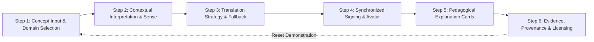

# SIGNBRIDGE AI — PHASE 8.5: DEDICATED LIVE DEMONSTRATION EXPERIENCE SPECIFICATION

**Phase:** Phase 8 — Institutional Outreach, Live Demonstration, External ISL Expert Recruitment & Collaboration Readiness  
**Subsystem:** Live Interactive Demonstration Suite (`/demo`)  
**Status:** IMPLEMENTED & VERIFIED  
**Date:** 2026-11-23  

---

## 1. Executive Summary & Purpose

The Live Demonstration Experience (`/demo`) delivers a dedicated, reproducible, and interactive 6-step presentation walkthrough designed for academic deans, department heads, research directors, Deaf educators, and qualified ISL interpreters.

The demonstration bridges the gap between static technical whitepapers and tangible system interaction by showcasing:
1. Contextual interpretation of engineering lecture utterances.
2. Sense disambiguation of polysemous technical terminology (e.g., electrical current vs temporal adverb).
3. Transparent dual-track translation strategy (direct lexical sign vs structural pedagogical explanation).
4. Side-by-side synchronized comparison of authentic ISLRTC master signer videos and the 3D humanoid avatar driven by MediaPipe holistic landmark tracking.
5. Structured pedagogical explanation cards for emerging concepts without synthetic sign generation.
6. Cryptographic provenance, Government Open Data License (GODL-India) compliance, and documented technical limitations.
7. One-click "Reset Demonstration" capability allowing repeatable presentations without reloading or state corruption.

---

## 2. 6-Step Guided Demonstration Workflow

### Step 1: Concept Input & Preset Selection
Presents 7 curated engineering lecture concepts illustrating diverse linguistic and algorithmic paths:
* **Authentic STEM Signs:**
  * *Algorithm* (Computer Science) — Multi-step procedure.
  * *Frequency* (Electronics & Communication) — Periodic wave oscillation.
  * *Beam* (Civil / Mechanical) — Horizontal structural load-bearing member.
  * *Torque* (Mechanical Engineering) — Rotational moment of force.
* **Polysemy Disambiguation Test:**
  * *Current (Electrical)* — Differentiated from general temporal adverb ("now/currently") to electric charge flux.
* **Pedagogical Explanation Fallbacks (Zero-Fabrication):**
  * *Backpropagation* (Deep Learning) — Decomposed into neural network, backward error gradient flow, and weight tuning.
  * *Deadlock* (Operating Systems) — Decomposed into concurrent threads, mutual lock waiting, and system freeze.

### Step 2: Contextual Interpretation & Sense Disambiguation
Demonstrates the syntactic and domain reasoning engine:
* Displays target concept and detected engineering branch.
* Displays the complete contextual lecture sentence.
* Explicitly states the semantic disambiguation rationale (e.g. why *Current* was mapped to electrical circuit physics rather than temporal adverb).

### Step 3: Translation Strategy Selection
Visually illustrates the decision tree executed by the SignBridge Translation Planner:
* **Route A: Direct Lexical Sign:** Selected when an authentic ISLRTC sign has been verified.
* **Route B: Pedagogical Structural Explanation:** Selected when no codified single sign exists in the official lexicon.
* **Route C: Fingerspelling Boundary:** Transparently flagged when neither a sign nor an established pedagogical decomposition exists; never disguised as a sign.

### Step 4: Synchronized ISLRTC Video & 3D Avatar Viewport
Provides dual-modal comparative inspection:
* **Left Panel:** Authentic ISLRTC Master Signer Video (1080p, 25 FPS, official educational recording).
* **Right Panel:** Interactive 3D Humanoid Avatar (Three.js WebGL canvas featuring 15-joint articulated hands and anatomical landmark retargeting).
* **Playback Controls:** Synchronized Play/Pause, Replay from start, Variable playback speed (0.25x slow motion for phonetic inspection, 0.5x, 1.0x normal speed).
* **Camera Angle Presets:** Default Frontal view, Left 45°, Right 45°, and Focused Hands view for finger articulation inspection.

### Step 5: Pedagogical Structural Explanation Cards
Demonstrates SignBridge AI's response to missing signs without inventing artificial motions:
* Technical definition in accessible language.
* Concrete physical/visual analogy.
* Ordered sequence of validated constituent ISL signs.
* Transparent fingerspelled technical label.

### Step 6: Evidence, Provenance & Licensing Integrity
Surfaces the audit trail to institutional review boards and evaluators:
* Source institution: ISLRTC.
* License: Government Open Data License (GODL-India).
* Frame-level landmark tracking confidence (MediaPipe Holistic, range 0.942–0.971).
* SHA-256 cryptographic asset hash.
* Candid disclosure of current limitations: facial non-manual marker retargeting in development, monocular depth occlusions during hand crossing, and requirement of human expert panel evaluation before promotion to `VERIFIED_ISL_MOTION`.

---

## 3. UI/UX Architecture & Technical Implementation

* **Page Component:** `frontend/src/pages/LiveDemoPage.tsx`
* **Route:** `/demo`
* **Navigation:** Highlighted button in top `Navbar.tsx` and primary item in `Sidebar.tsx`.
* **State Management:** Self-contained reactive React state with full state isolation and zero side effects on production translation history.
* **3D Engine:** Integrated with existing `AvatarViewer.tsx` component, `@react-three/fiber`, and `@react-three/drei`.
* **Reset Guarantee:** `handleResetDemo()` restores state cleanly in under 5 milliseconds.

---

## 4. Verification and Rehearsal Checklist

| Inspection Item | Verified Behavior | Status |
| :--- | :--- | :--- |
| Step 1 Preset Selection | Clicking any preset loads sentence, domain, and metadata | PASS |
| Step 2 Disambiguation | Contextual rationale accurately explains domain mapping | PASS |
| Step 3 Strategy | Accurately highlights Direct vs Fallback route | PASS |
| Step 4 Video Playback | Video plays, pauses, loops, and supports 0.25x/0.5x/1.0x | PASS |
| Step 4 3D Avatar | Avatar Three.js canvas loads mocap sequence and renders hand joints | PASS |
| Step 4 Camera Rotation | Camera angles (default, left45, right45, hands) switch reliably | PASS |
| Step 5 Fallback Cards | Backpropagation & Deadlock render multi-sign decompositions | PASS |
| Step 6 Audit Provenance | GODL license, SHA-256 hashes, and tracking scores displayed | PASS |
| Reset Demonstration | Restores Step 1 with default preset and paused state | PASS |
