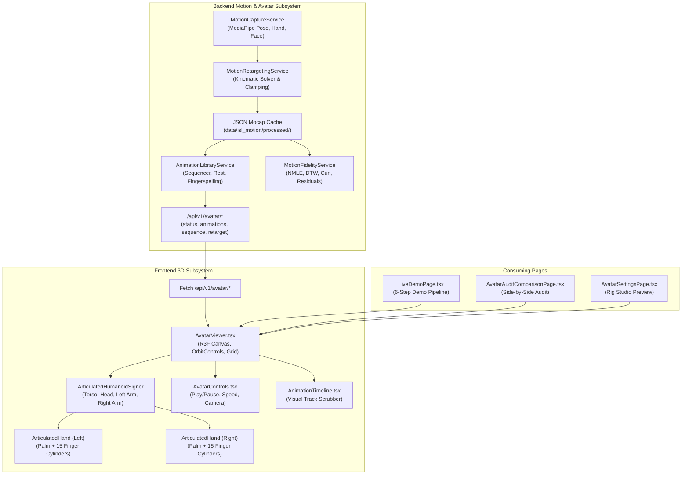

# SIGNBRIDGE AI — PHASE 8.6
# 3D AVATAR ARCHITECTURE & SUBSYSTEM AUDIT

**Project:** `E:\SignBridgeAi`  
**Subsystem:** 3D Humanoid Avatar, Three.js, React Three Fiber, Animation Pipeline  
**Audit Date:** 2026-11-23  
**Auditor:** Independent 3D Character Technical Artist, Animation Systems Engineer & Systems Auditor  

---

## 1. EXECUTIVE SUMMARY

An exhaustive architectural investigation was conducted across the entire frontend (`frontend/src/components/avatar/`, `frontend/src/pages/`) and backend (`backend/app/services/`, `backend/app/api/endpoints/`) codebase of SignBridge AI.

The investigation examined every component associated with Three.js, React Three Fiber (R3F), Drei, 3D character modeling, rigging, kinematics, animation sequencing, and video synchronization.

### Key Architectural Discovery
1. **No External GLTF / GLB Character Assets:**  
   The project does not load or depend on external binary `.glb` or `.gltf` 3D model files.
2. **Procedural Hierarchy vs Skinned Mesh:**  
   The avatar is implemented as a procedural hierarchy of 51 Three.js geometry primitives (`boxGeometry`, `cylinderGeometry`, `sphereGeometry`, `coneGeometry`) within React Three Fiber components. There is **no `THREE.SkinnedMesh`**, **no `THREE.Skeleton`**, **no bone vertex weighting**, and **no `THREE.AnimationMixer`**.
3. **Rig Designation (`SignBridge-Articulated-54`):**  
   The specification refers to 54 anatomical kinematic degrees of freedom / control points (chest [3], head [3], neck [3], shoulders [6], upper arms [6], forearms [2], wrists [6], finger phalanges [30], facial blendshape proxies [4]).
4. **Playback Clock Decoupling:**  
   The playback engine in `AvatarViewer.tsx` operates on an uncoupled internal `setInterval(..., 33)` at 30 FPS. In both `LiveDemoPage.tsx` and `AvatarAuditComparisonPage.tsx`, the parent pages maintain separate video playback clocks, causing dual-viewports to desynchronize immediately.

---

## 2. COMPONENT INVENTORY & DEPENDENCY GRAPH

---

## 3. COMPONENT FILE AUDIT

| File | Subsystem | Implementation Type | Observed Architectural Role |
|---|---|---|---|
| `frontend/src/components/avatar/AvatarViewer.tsx` | Viewport & Rig | React Three Fiber / Canvas | Main 3D viewport containing `ArticulatedHumanoidSigner`, lighting, materials, and internal time stepping loop. |
| `frontend/src/components/avatar/AvatarControls.tsx` | Transport UI | React DOM | Playback buttons, speed multipliers (0.25x, 0.5x, 1.0x, 1.5x), camera presets (`default`, `left45`, `right45`, `face`, `hands`), frame stepping. |
| `frontend/src/components/avatar/AnimationTimeline.tsx` | Timeline UI | React DOM | Interactive track scrubber displaying lexical signs, pauses, and rest tracks. |
| `frontend/src/components/avatar/AnimationStatusBadge.tsx` | Verification HUD | React DOM | Visual indicator displaying `PARTIALLY_VERIFIED_MOTION`, `VERIFIED_ISL_MOTION`, `DEMO_ONLY`. |
| `frontend/src/pages/LiveDemoPage.tsx` | Live Demo | React Page | 6-step college presentation workflow with side-by-side video and 3D avatar viewport. |
| `frontend/src/pages/AvatarAuditComparisonPage.tsx` | Audit Page | React Page | Side-by-side comparison with authentic ISLRTC video, master scrubber, and quantitative fidelity readout. |
| `backend/app/services/motion_capture_service.py` | Computer Vision | MediaPipe + OpenCV | Extracts 33 pose, 21 hand, and 468 face landmarks from video; applies One-Euro filter and shoulder normalization. |
| `backend/app/services/motion_retargeting_service.py` | Kinematics | NumPy / Trigonometry | Calculates shoulder pitch/yaw, elbow flexion, 15 finger phalange angles, and facial blendshapes with joint limit clamping. |
| `backend/app/services/animation_library_service.py` | Sequencing | Python Service | Assembles multi-token timelines, loads mocap files, and generates fingerspelling fallbacks. |
| `backend/app/services/motion_fidelity_service.py` | Quality Assurance | NumPy / DTW | Reconstructs avatar arm trajectories, computes NMLE, DTW, and per-joint residual errors. |

---

## 4. ARCHITECTURAL LIMITATIONS IDENTIFIED

1. **Absence of Skeletal Skinning:**  
   Because the character is constructed from unconnected primitive shapes (boxes and cylinders) grouped hierarchically, there is no smooth skin envelope. Mesh geometry visibly clips at elbow and finger pivots.
2. **Prop Drilling Gap:**  
   `AvatarViewer` was written as a self-contained widget. It initially failed to expose controlled props for `currentTime`, `isPlaying`, `speed`, and `cameraPreset`, preventing parent pages from synchronizing the 3D model with external video players.
3. **Euler Angle Discontinuities:**  
   The retargeting engine solves kinematics directly to Euler angles rather than quaternions. Rapid arm elevations near $90^\circ$ exhibit gimbal-lock vulnerability and sudden sign flips in yaw.

